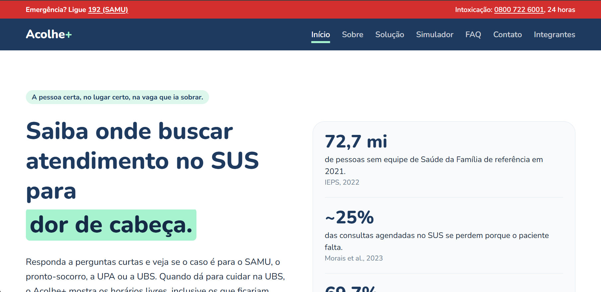
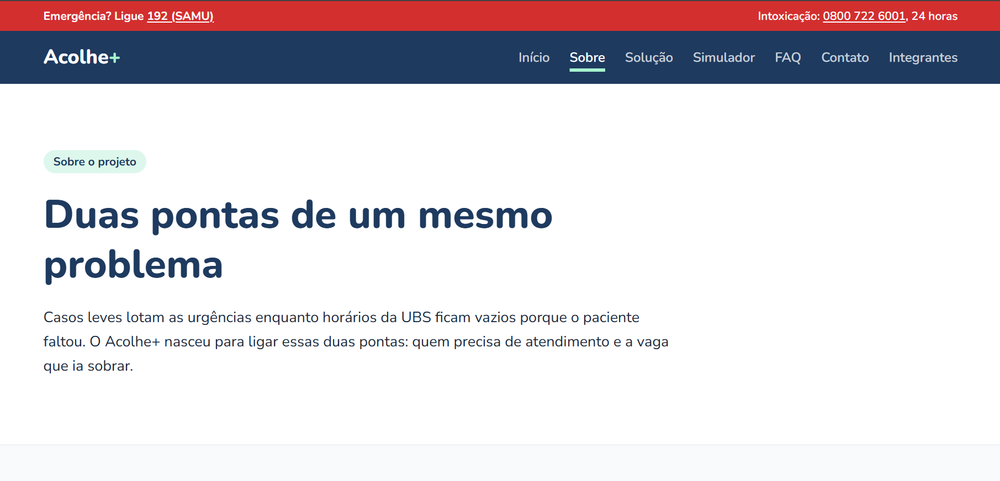
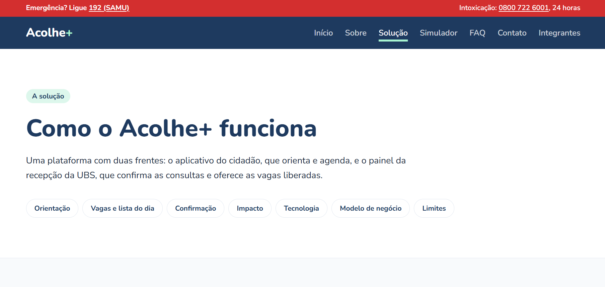
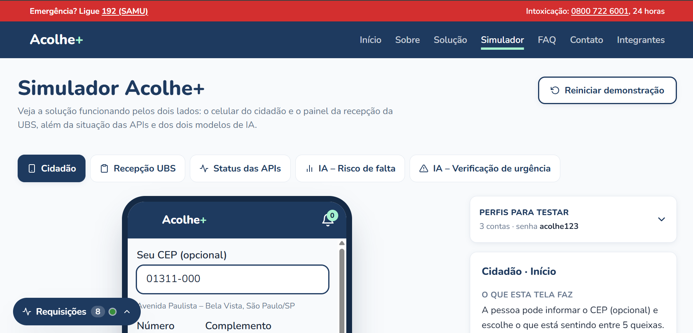
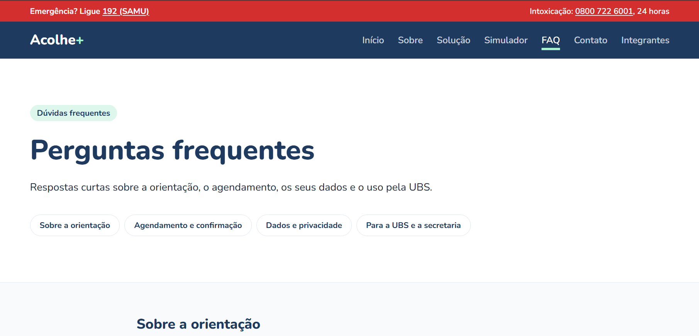
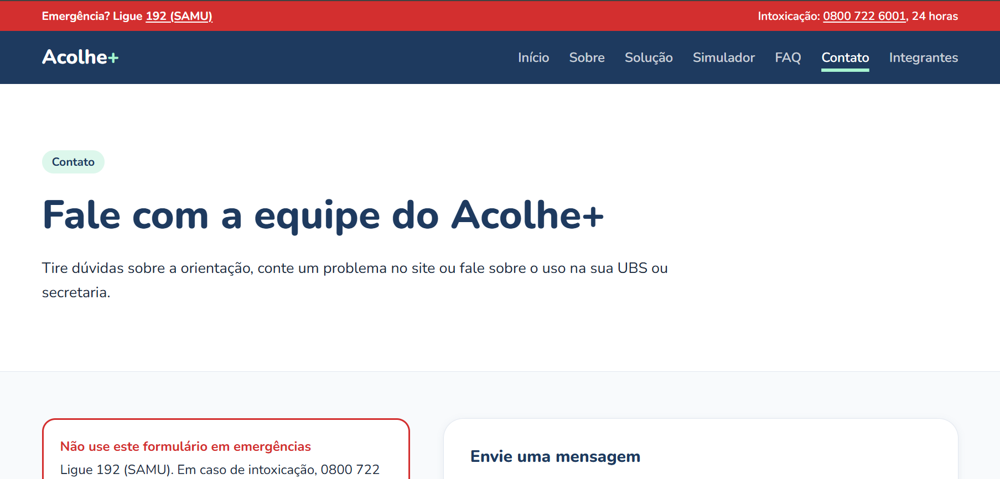
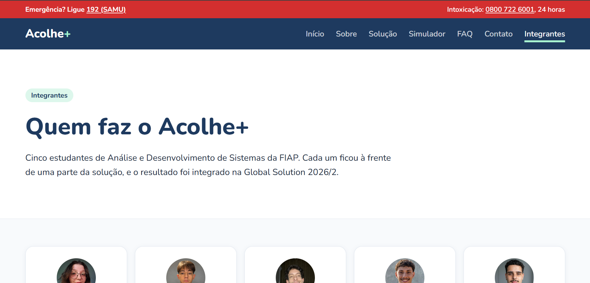

# Acolhe+

> Orientação em saúde e agendamento na UBS, com menos faltas e mais vagas aproveitadas no SUS.

Projeto da **Global Solution FIAP 2026/2** (tema CitizenTech) · Front-end · versão **1.0.0**

## Links

| O quê | URL |
|---|---|
| **GitHub (este repositório)** | https://github.com/GlobalSolution-2026/acolhe-mais-front |
| **Vercel (site publicado)** | https://acolhe-mais-gs.vercel.app/ |
| **API Java (Spring Boot)** | https://acolhe-mais-java.onrender.com · repositório: https://github.com/GlobalSolution-2026/Acolhe-Mais-Java |
| **API Flask (IA)** | https://acolhe-mais-ia.onrender.com · repositório: https://github.com/GlobalSolution-2026/Acolhe-Mais_IA |
| **YouTube (vídeo de apresentação)** | [PREENCHER: link do YouTube] |

> As APIs estão no plano gratuito do Render, que "dorme" sem uso: a primeira chamada pode levar até um minuto.

---

## Sumário

- [Objetivo](#objetivo)
- [Sobre o projeto](#sobre-o-projeto)
- [Funcionalidades](#funcionalidades)
- [Telas](#telas)
- [Tecnologias](#tecnologias)
- [Como rodar](#como-rodar)
- [Variáveis de ambiente](#variáveis-de-ambiente)
- [Rotas](#rotas)
- [Integração com as APIs](#integração-com-as-apis)
- [Estrutura de pastas](#estrutura-de-pastas)
- [Contas para testar](#contas-para-testar)
- [Limitações desta versão](#limitações-desta-versão)
- [Integrantes](#integrantes)
- [Contato](#contato)

---

## Objetivo

Ajudar a pessoa a saber **para onde ir** quando sente algum sintoma (SAMU, pronto-socorro, UPA ou UBS) e, nos casos leves, **agendar na UBS** com confirmação, para reduzir as faltas e reaproveitar os horários que seriam perdidos, oferecendo-os a quem foi à UBS sem horário.

## Sobre o projeto

O **Acolhe+** junta duas ideias:

1. **Orientação:** a pessoa responde perguntas sobre uma queixa (inspiradas no Protocolo de Manchester) e recebe uma cor de gravidade e um destino: SAMU 192, pronto-socorro, UPA ou UBS. A plataforma **orienta, não faz diagnóstico**.
2. **Agendamento e faltas no SUS:** nos casos de baixa gravidade (verde e azul), a pessoa agenda na UBS. A UBS pede confirmação antes da consulta; quem não confirma tem o horário liberado, e a vaga é oferecida à **lista do dia** (quem foi à UBS sem horário).

O cenário principal é São Paulo, em bairros sem equipe forte de Saúde da Família. O modelo de negócio é B2G: a secretaria de saúde paga, e o cidadão usa de graça.

Há **dois modelos de IA** (API Flask):

- **Risco de falta:** probabilidade de a pessoa faltar à consulta. Risco ALTO a partir de **0,60**, com pedido de confirmação mais cedo e lembrete extra.
- **Verificação de urgência:** confere se um caso que deu verde ou azul pode ser urgente. **Só pode elevar a gravidade, nunca baixar.**

## Funcionalidades

### Páginas institucionais
Home, Sobre, Solução (com o impacto esperado), FAQ, Contato e Integrantes (com página de cada integrante em `/integrantes/:rm`).

### Simulador (`/simulador`)
Mostra a solução funcionando pelos dois lados, com um painel de explicação em cada tela (o que a tela faz, regras de negócio e endpoints usados).

| Aba | O que mostra |
|---|---|
| **Cidadão** | Celular com Início (CEP opcional e 5 queixas), orientação passo a passo, resultado por cor, Emergência (SAMU 192 com roteiro da ligação), UBS próximas e horários, entrar e criar conta, agendamento, minhas consultas, avisos, perfil e ficha de saúde |
| **Recepção UBS** | Agenda do dia (presença e falta), Balcão (orientação feita ali ou pelo código do app), Pendentes (risco ALTO primeiro), Lista do dia com oferta de vaga e Indicadores |
| **Status das APIs** | Situação da API Java, da API Flask e do ViaCEP, tabela de endpoints e as requisições feitas enquanto se navega |
| **IA – Risco de falta** | Formulário com os atributos do Modelo 1, probabilidade, risco e consequência na solução |
| **IA – Verificação de urgência** | Formulário com os atributos do Modelo 2, resultado e a regra "só pode elevar" |

Toda tela que chama API trata **carregando, erro e vazio**.

## Telas

### Início


### Sobre


### Solução


### Simulador


### FAQ


### Contato


### Integrantes


## Tecnologias

- **React 19** + **Vite** + **TypeScript**
- **Tailwind CSS v4** (tokens de cor no `@theme` do `index.css`)
- **React Router** (`createBrowserRouter`, `Outlet`, `NavLink`, `Navigate`)
- **Context API** com hooks próprios (`useSimulador`, `useRequisicoes`, `useAvisos`)
- **React Hook Form** (validação nativa: `required`, `pattern`, `validate`)
- **React Icons**
- **Fetch API** para todas as requisições
- Deploy na **Vercel** (SPA com `vercel.json`)

## Como rodar

Pré-requisito: **Node.js 20.19** ou mais recente (exigência da Vite 8).

```bash
git clone https://github.com/GlobalSolution-2026/acolhe-mais-front.git
cd acolhe-mais-front
npm install
cp .env.example .env   # opcional: sem as URLs, roda em modo demonstração
npm run dev
```

Abra `http://localhost:5173`.

Outros comandos:

```bash
npm run build    # tsc + build da Vite
npm run lint     # ESLint
npm run preview  # serve o build localmente
```

## Variáveis de ambiente

| Variável | Para que serve | Vazia |
|---|---|---|
| `VITE_API_URL` | URL da API Java: `https://acolhe-mais-java.onrender.com` | Modo demonstração: os dados vêm do próprio front |
| `VITE_FLASK_URL` | URL da API Flask de IA: `https://acolhe-mais-ia.onrender.com` | Modo demonstração: mesma simulação do protótipo |

Quando uma API está em modo demonstração, a tela mostra o selo **"Demonstração"**. Na Vercel, as variáveis ficam em *Settings → Environment Variables*. O `.env` nunca é commitado.

## Rotas

| Rota | Página |
|---|---|
| `/` | Home |
| `/sobre` | Sobre |
| `/solucao` | Solução |
| `/faq` | FAQ |
| `/contato` | Contato |
| `/integrantes` e `/integrantes/:rm` | Integrantes |
| `/simulador/cidadao/...` | Celular do cidadão (inclui `ubs/:idUnidade`) |
| `/simulador/recepcao/...` | Agenda, Balcão, Pendentes, Lista do dia e Indicadores |
| `/simulador/status` | Status das APIs |
| `/simulador/ia-risco-falta` | IA – Risco de falta |
| `/simulador/ia-urgencia` | IA – Verificação de urgência |
| qualquer outra | Página não encontrada (404) |

## Integração com as APIs

Toda chamada passa por `src/services/`, com uma função por endpoint. Cada função tem dois caminhos: com a variável de ambiente, faz o `fetch` real; sem ela, usa o modo demonstração. Os erros da API (`ErroDTO { status, mensagem }`) viram a mensagem mostrada na tela.

### API Java (`VITE_API_URL`)

URL: https://acolhe-mais-java.onrender.com · Repositório: https://github.com/GlobalSolution-2026/Acolhe-Mais-Java

| Método | Rota | Onde é usada |
|---|---|---|
| GET | `/unidades` | UBS próximas, UPA indicada, seletor da Recepção |
| GET | `/unidades/{id}` | Topo da tela de horários |
| GET | `/unidades/{id}/horarios` | Horários da UBS, Agenda da Recepção |
| POST | `/cidadaos` | Criar conta, cadastro no Balcão |
| GET | `/cidadaos/{id}` | Perfil, Agendar |
| GET | `/cidadaos?cns={nrCns}` | Busca no Balcão e na Agenda |
| PUT | `/cidadaos/{id}` | Editar perfil, Agendar |
| POST | `/cidadaos/login` | Entrar (Cartão SUS + senha) |
| GET | `/consultas` | Minhas consultas, avisos, Agenda, Pendentes, Indicadores |
| POST | `/consultas` | Agendar (409 quando o horário acabou de ser ocupado) |
| PUT | `/consultas/{id}/status` | Confirmar, cancelar, presença e falta |

### API Flask de IA (`VITE_FLASK_URL`)

URL: https://acolhe-mais-ia.onrender.com · Repositório: https://github.com/GlobalSolution-2026/Acolhe-Mais_IA

| Método | Rota | Onde é usada |
|---|---|---|
| GET | `/status` | Status das APIs |
| POST | `/prever-falta` | Ao agendar e na aba IA – Risco de falta |
| POST | `/verificar-urgencia` | No fim da orientação (verde/azul) e na aba IA – Verificação de urgência |

### API externa

| Método | Rota | Uso |
|---|---|---|
| GET | `https://viacep.com.br/ws/{cep}/json/` | Completa o endereço a partir do CEP |

## Estrutura de pastas

```
docs/telas/       imagens das telas usadas neste README
src/
├── components/   componentes reutilizáveis (celular, recepção, IA, status, orientação)
├── context/      SimuladorContext e RequisicoesContext (Context API) e seus hooks
├── data/         dados fixos e de exemplo (queixas, perguntas, unidades, textos das páginas)
├── hooks/        hooks próprios (useCarregar, useAvisos, useEntrarNaListaDoDia)
├── lib/          datas, feriados e relógio do app
├── pages/        páginas institucionais e o simulador (cidadao, recepcao, status, ia)
├── routes/       router.tsx (createBrowserRouter)
├── services/     chamadas às APIs e regras de negócio puras
├── types/        tipos TypeScript (nomes dos DTOs da API Java)
└── utils/        validações, formatadores e mensagens de erro
```

## Contas para testar

No simulador, o painel **"Perfis para testar"** entra com um clique. A senha das contas de teste é `acolhe123`.

| Conta | Cartão SUS | Situação |
|---|---|---|
| Maria Silva | `111222233334444` | Conta principal, com consultas para confirmar e cancelar e ficha de saúde |
| Pedro Lima | `444555566667777` | Sem faltas (risco baixo) |
| Carlos Nunes | `666777788889999` | Consultas confirmadas |

## Limitações desta versão

- **Sempre em demonstração** (não existem na API Java): lista do dia, ofertas de vaga, orientação salva com o código para a recepção, vínculo da orientação no balcão e ficha de saúde (prévia da integração com o Meu SUS).
- **Uma consulta ativa por pessoa por dia** é uma regra conferida só no front; a API Java ainda não valida.
- **UPA e UBS "mais próximas"** são indicadas pelos 3 primeiros números do CEP (região), uma aproximação sem mapa. Uma evolução seria guardar latitude e longitude das unidades.
- **Modelo de risco de falta:** o SMS vai sempre como não recebido no momento do agendamento, e o bairro não é enviado.
- O **"Entrar com gov.br"** fica desativado até a adesão do município.
- A API no Render gratuito "dorme": a primeira chamada pode demorar.

## Integrantes

| Nome | RM | Turma | Função | GitHub | LinkedIn |
|---|---|---|---|---|---|
| Ana Carolina Orcelli Bautzer | 570281 | 1TDSPI | Líder do projeto | [anabautzer](https://github.com/anabautzer) | [LinkedIn](https://www.linkedin.com/in/ana-bautzer/) |
| Cauã Mathias Bertini | 570451 | 1TDSPI | Back-end (Python) | [cauabertini](https://github.com/cauabertini) | [LinkedIn](https://www.linkedin.com/in/caua-mathias-bertini/) |
| Eduardo Lima de Souza | 570412 | 1TDSPI | Front-end | [duduutech](https://github.com/duduutech) | [LinkedIn](https://www.linkedin.com/in/duduutech/) |
| Nicolas Frazão Vieira Molina | 568780 | 1TDSPO | Inteligência artificial | [Frazaomol](https://github.com/Frazaomol) | [LinkedIn](https://www.linkedin.com/in/nicolas-molina-3a9257355/) |
| Nicolas Rodrigues Martins | 573178 | 1TDSPW | Back-end (Java) | [NickRM22](https://github.com/NickRM22) | [LinkedIn](https://www.linkedin.com/in/nicolas-rodrigues-martins-126607360/) |

## Contato

- **E-mail do grupo:** [PREENCHER: e-mail de contato]
- **Integrantes:** pelo GitHub e pelo LinkedIn de cada pessoa, na tabela acima.
- **Dúvidas sobre o projeto:** abra uma *issue* em https://github.com/GlobalSolution-2026/acolhe-mais-front/issues
